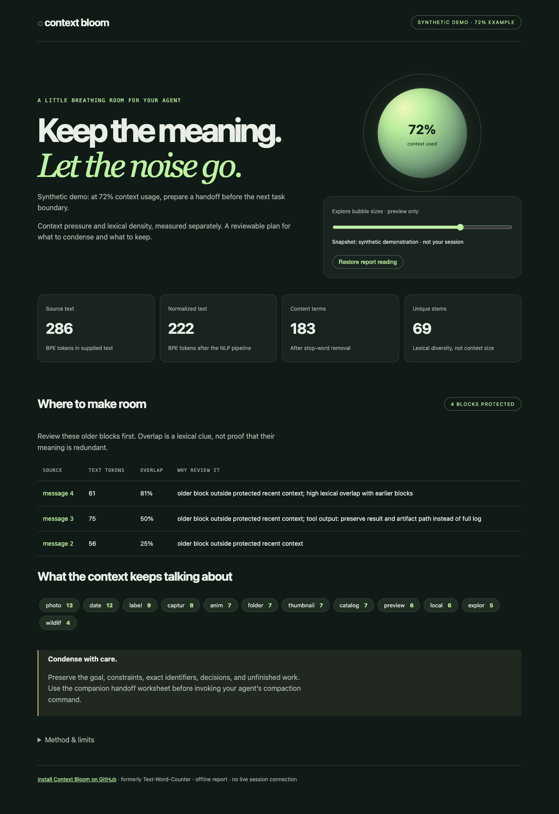
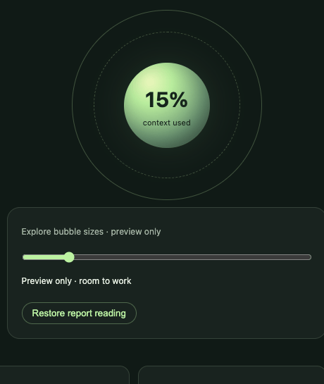

# Context Bloom


**A compaction companion for Codex and Claude Code.** Measure text, spot older context worth condensing, and prepare a handoff before your agent runs out of room.

[Interactive report demo](https://eforus-overseer.github.io/context-bloom/) · [Install the skill](#install) · [How it works](#three-measurements-not-one) · [Original word counter](legacy/)



## What you get

- **English NLP analysis:** POS-aware lemmatization, stop-word removal with negations retained, then Porter stemming. Count BPE tokens before and after normalization.
- **Where to compact:** ranked older blocks with exact line ranges or message numbers, token counts, and lexical overlap. Recent context, user instructions, fenced code, and likely unfinished work are protected.
- **When to compact:** configurable prepare/compact bands based on supplied host context usage. Unknown usage stays unknown.
- **A visible indicator:** a growing circle and usage bar in Claude Code's terminal status line, plus a smooth resizing bubble in the offline report.
- **A handoff worksheet:** preserve the goal, decisions, constraints, verified results, and next action before using your agent's compaction command.

It advises; it never silently deletes messages, rewrites prompts, or triggers compaction.

## Install

Requires Python 3.10+. The personal-skill installer uses symlinks on macOS/Linux, so keep the checkout in place. It refuses to replace another skill or status line.

```bash
git clone https://github.com/eforus-overseer/context-bloom.git
cd context-bloom
python3 -m venv skills/context-bloom/.venv
skills/context-bloom/.venv/bin/python -m pip --isolated install --index-url https://pypi.org/simple -r skills/context-bloom/requirements.txt
skills/context-bloom/.venv/bin/python skills/context-bloom/scripts/setup.py
python3 tools/install.py --target both
```

Setup downloads the NLP resources and tokenizer tables once. Subsequent analysis is offline, with no API key or inference bill. Install only one host with `--target codex` or `--target claude`. Windows users can copy `skills/context-bloom` to their personal skill directory and follow the [setup reference](skills/context-bloom/references/setup.md).

- **Codex:** invoke `$context-bloom`. Installed in `~/.agents/skills/context-bloom`.
- **Claude Code:** invoke `/context-bloom`. Installed in `~/.claude/skills/context-bloom`.

If a new skill does not appear, restart the client. The skill is also packaged as a Claude Code plugin:

```text
/plugin marketplace add eforus-overseer/context-bloom
/plugin install context-bloom@context-bloom
```

For the plugin installation, follow `references/setup.md` inside the installed skill directory to prepare its environment, then invoke `/context-bloom:context-bloom`. Plugin updates may require repeating setup. The plugin does not automatically change your status line.

### Add the terminal bubble

```bash
python3 tools/install.py --target claude --statusline
```

This adds Claude's status command, backs up existing settings, and preserves other settings. An existing different status line is left untouched; [compose it manually](skills/context-bloom/references/integrations.md) if desired.

```text
○ Bloom [━━────────] 24% · room to work
● Bloom [━━━━━━━───] 72% · prepare handoff
⬤ Bloom [━━━━━━━━━─] 91% · compact at next safe boundary
```



The glyph grows in discrete stages; `--ascii` is available. It reads Claude's host-provided context usage, including cached input in the fallback calculation, and needs only Python's standard library. It does not run NLP on each redraw.

**Codex UI boundary:** use `/statusline` in Codex CLI for its native context meter. This project does not inject a custom bubble into the Codex desktop toolbar or Claude's web app. Its graphical bubble is in the standalone report, which is a snapshot with a clearly labeled preview slider. See [supported integrations](skills/context-bloom/references/integrations.md).

## Try it

```bash
python3 skills/context-bloom/scripts/run.py examples/session.json \
  --format messages --context-used 144000 --context-limit 200000 \
  --out reports/bloom.json
```

Open `reports/bloom.html`. The command also writes `reports/bloom.json` and `reports/bloom.handoff.md`. The supplied 72% usage is a **synthetic demonstration**, not a reading of your current session.

For your own Markdown/text file:

```bash
python3 skills/context-bloom/scripts/run.py context.md --out reports/my-context.json
```

For exported messages, supply a JSON array of objects with `role` and string `content`; supported roles are `system`, `developer`, `user`, `assistant`, and `tool`. This is an explicit interchange format, not an importer for native Codex/Claude session logs. The tool reads only the file you select.

Optional flags: `--encoding o200k_base`, `--keep-recent 4`, `--prepare 70`, `--compact 85`. By default the last two blocks/messages are protected; add `<!-- bloom:keep -->` within any other block you want retained. Input is limited to 2 MB / 2,000 blocks. No user transcript data is included in this repository.

## Three measurements, not one

| Measurement | What it means | What it does not mean |
|---|---|---|
| Source-text tokens | Exact tiktoken count of supplied text under the named encoding | Full session usage, Claude's tokenizer count, or a billed request total |
| Normalized-text tokens | Token count after English lemmatization → stop-word removal → stemming | Context size or safe realized savings |
| Host context usage | Current usage supplied by the host/status payload or explicitly by the user | A number inferred from normalized words |

Stemming is deliberately lossy: word forms merge, punctuation and syntax disappear, and meaning can change. The normalized representation is for analysis only. For example, `children → child`, `running → run`, and `playing → play`; negations such as `not` remain. The report retains source locations so you can inspect original wording.

Candidate ranking combines source-text size with overlap in stems seen earlier. Repeated vocabulary does not prove repeated meaning. The 65% / 80% timing bands are configurable heuristics, not provider limits or guarantees. Always retain active goals, corrections, constraints, exact identifiers, and unresolved tasks in the handoff.

## Privacy and limitations

After explicit setup, analysis and rendering work locally without network calls. Reports include derived terms, source coordinates, counts, and an input hash; those can still reveal sensitive topics. Keep real reports in the ignored `reports/` directory. The HTML contains no external fonts, scripts, or analytics.

Linguistic normalization supports English prose. Code, non-English text, mixed languages, and semantic contradictions require human review. Source-text token counts exclude hidden instructions, message framing, images, tools, and other host-managed context. The tool does not inspect session directories automatically.

## A second life for Text-Word-Counter

This repository began as **Text-Word-Counter**, a hand-written Python ebook counter whose original commits date to November 2020. The original program and sample files remain in [`legacy/`](legacy/), with the pre-migration revision tagged `legacy-word-counter`. Git history is preserved. Run the old script from its own directory:

```bash
cd legacy
python3 TextCounter.py
```

Context Bloom expands that early word-counting idea into an agent skill. The old repository URL redirects here after the rename. [Ponytail](https://github.com/DietrichGebert/ponytail) inspired the installable skill/plugin format; this project's code and purpose are independent.

## Develop and contribute

```bash
skills/context-bloom/.venv/bin/python -m unittest discover -s tests -v
```

Tests cover real NLP transformations, cache-aware context usage, missing telemetry, preserved instructions, input protection, HTML escaping, offline execution, and non-destructive installation.

Useful next contributions: multilingual normalization with explicit language models; evaluated semantic redundancy detection; documented session-export adapters; and a supported live Codex indicator when the host exposes an extension interface. [Method and design](docs/design.md) · [Contributing](CONTRIBUTING.md).
